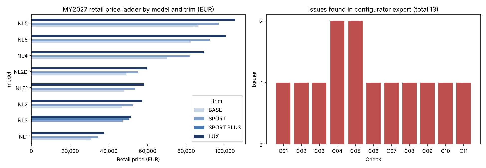

# Car Price List & Configurator Data Quality Checks (Excel + Python + SQL)

**Before a new model-year price list goes live, does the pricing database used by the online configurator and by invoicing match the approved price list?**

This project simulates the work of a pricing / product management team at a car importer: update the price list from MY2026 to MY2027, calculate retail prices (VAT and registration tax), and reconcile the system export against the approved list with automated checks in Excel, Python and SQL.

> **Fictional data.** "Northline Motors", its models and prices are invented for practice. The registration-tax scale is **illustrative** and is **not** the Greek law in force. The data is generated by `generate_data.py`; the errors in the configurator export were planted on purpose so the checks can be tested.



## Questions
1. How do net prices change from MY2026 to MY2027 (price updates, new and discontinued variants)?
2. Does every retail price follow the pricing rule (VAT, registration tax, rounding)?
3. Does the configurator / invoicing export match the approved price list for variants, options and packages?
4. Do Excel, Python and SQL give the same answer?

## Data (fictional)
| File | Content |
|---|---|
| `variants_my2026.csv` | 24 variants (8 models × 3 trims): fuel, power, CO2, MY2026 net price |
| `price_list_my2027_approved.csv` | approved MY2027 list: 24 variants (1 new, 1 discontinued), net price, registration tax, retail price |
| `options_my2026.csv`, `options_my2027_approved.csv` | options with price, availability by model and rules (e.g. tow hitch not on EVs) |
| `packages_my2027.csv` | 3 option packages |
| `configurator_export_my2027.csv` | 45 rows currently loaded in the configurator / invoicing database (variants, options, packages) |

**Pricing rule.** Registration tax = net price × band rate (by net price) × CO2 multiplier (EV = 0). Retail price = net price × 1.24 (VAT 24%) + registration tax, rounded up to the next €10. MY2027 update: +2% net for petrol and diesel, +3% for PHEV, 0% for EV, +3% for options.

## Method
1. **Excel workbook (`price_list_checks.xlsx`)**
   - `Parameters`: VAT, tax bands and CO2 multipliers as input cells; every price formula reads them (`LOOKUP`, `ROUND`, `ROUNDUP`).
   - `Approved_MY2027`: retail price recalculated with formulas for all 24 variants; matches the approved file exactly.
   - `Change_Log`: MY2026 vs MY2027 with `INDEX/MATCH`, % change and status (new, discontinued, price update).
   - `Checks_Variants`, `Checks_Options`, `Checks_Packages`: one formula flag per check (`INDEX/MATCH`, `COUNTIF`, `COUNTIFS`, `MOD`, `SEARCH`) with conditional formatting.
   - `Summary`: issues per check and a reconciliation cell against the Python total.
2. **Python (`price_list_checks.ipynb`, pandas)**: the same rule as a function, the price change log, 11 automated checks written to `issue_log.csv`, the price ladder by trim and the registration-tax share by fuel.
3. **SQL (SQLite, the three `.sql` files)**: price mismatches with a `JOIN`, missing / not-approved / duplicate codes with `LEFT JOIN`, `UNION ALL`, `GROUP BY … HAVING`, and package value vs options with a recursive CTE that splits the option list.
4. **Reconciliation**: Excel, Python and SQL return the same issues (13 in total; the 5 variant price issues are identical in Python and SQL).

## Key findings
- **MY2027 update:** 23 price updates, 1 new variant (NL3-SPORTPLUS) and 1 discontinued (NL3-BASE). Average net change +2.0% (petrol, diesel), +3.0% (PHEV), 0.0% (EV).
- **13 issues in 12 rows of the configurator export**, across all 11 checks:

| Check | Example found | Impact |
|---|---|---|
| C07 EV with CO2 > 0 | NLE1-BASE loaded with 120 g/km, so registration tax was charged | Retail €53,900 instead of €47,740 (+€6,160) |
| C05 Retail ≠ rule | NL1-SPORT retail calculated with the wrong VAT | Retail €31,620 instead of €34,440 (−€2,820) |
| C04 Net ≠ approved | NL2-LUX still at the MY2026 net price; NL4-SPORT typo (digits swapped) | €38,920 vs €39,700; €51,810 vs €51,180 |
| C01 / C02 | New NL3-SPORTPLUS not loaded; discontinued NL3-BASE still active | Customers cannot order the new variant / can order a dropped one |
| C03 / C06 | Duplicate NLE1-LUX row; NL5-BASE retail €86,337 not rounded | |
| C08–C10 Options | OP14 sport exhaust still active after discontinuation; OP10 at the old price (€1,240 vs €1,280); tow hitch offered on the EV | |
| C11 Package | Winter Pack €1,450 while its options cost €1,410 separately | Package costs the customer €40 more |

- **Price ladder:** SPORT is +12% and LUX +22% over BASE for most models. NL4 SPORT is +16.4% because its CO2 (164 g/km) crosses the 160 g/km step into a higher tax multiplier: a small specification change can move a variant into a more expensive tax bracket.
- **Tax share (illustrative scale):** registration tax averages 14.4% of retail price for petrol, 17.7% for diesel, 4.6% for PHEV and 0% for EV.

## Limitations
- All data is fictional and the errors were planted, so the issue counts show the method, not a real error rate.
- The registration-tax scale is simplified and illustrative; the real Greek rules (and VAT treatment of the tax) differ and change over time.
- The export has one row per option, not one row per option × model, so availability is checked against a list of models in one field.

## SQL queries
| File | What it answers |
|---|---|
| `01_variant_price_mismatch.sql` | Variants whose net or retail price in the export differs from the approved list |
| `02_missing_and_discontinued.sql` | Approved variants missing from the export, export variants not approved, duplicate codes |
| `03_package_vs_options.sql` | Package price vs the sum of its options (recursive CTE) |

## Repository structure
All files are in the repository root.
```
car-price-list-quality-checks/
├── README.md
├── price_ladder_and_issues.png
├── price_list_checks.xlsx                 Excel workbook: parameters, price list, change log, checks, summary
├── price_list_checks.ipynb                Python notebook: pricing rule, change log, 11 checks, SQL cross-check, charts
├── generate_data.py                       creates the fictional CSV files (fixed content, reproducible)
├── variants_my2026.csv
├── options_my2026.csv
├── price_list_my2027_approved.csv
├── options_my2027_approved.csv
├── packages_my2027.csv
├── configurator_export_my2027.csv
├── issue_log.csv                          output: one row per issue found
├── price_change_log.csv                   output: MY2026 vs MY2027 per variant
├── 01_variant_price_mismatch.sql
├── 02_missing_and_discontinued.sql
└── 03_package_vs_options.sql
```

## Tools
Microsoft Excel (INDEX/MATCH, COUNTIFS, LOOKUP, conditional formatting) · Python (pandas, Matplotlib) in Jupyter · SQL (SQLite)
